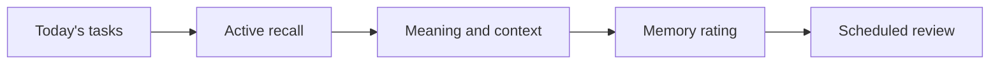

# Word World

**An offline, context-first vocabulary learning app for China's postgraduate English I examination.**

**Language / 语言: [简体中文](README.md) | English**

[](https://github.com/Alioth-31/Word-World/actions/workflows/test.yml)
[](LICENSE)
[](https://github.com/Alioth-31/Word-World/actions/workflows/build-apk.yml)

<p align="center">
  
  &nbsp;&nbsp;
  
</p>
<p align="center"><sub>Real interface screenshots using the bundled demo vocabulary</sub></p>

## Overview

Word World separates **dictionary lookup** from **memory practice**. A lookup shows definitions immediately; study sessions begin with active recall, followed by meaning and contextual examples, four-grade feedback, and spaced scheduling. Study progress remains on the device by default.



**Features**

- Daily tasks: due reviews first, then new vocabulary.
- Focused practice: recall, reveal, contextual examples, and four-grade feedback.
- Dictionary: Chinese/English search, priority filters, bookmarks, and word details.
- Local records: on-device progress and JSON import/export.
- Spaced repetition: Android builds integrate `ts-fsrs`; standalone HTML previews use a simplified fallback scheduler.

## Browser preview

Requires **Node.js 22+**. From the repository root:

```bash
npm test
npm run preview
```

Open `output/preview.html`. No Android SDK is needed. The preview contains **125 demo entries**; these are not independently verified English I word-frequency or sense-importance rankings.

## Android build

Open [GitHub Actions · Android APK](https://github.com/Alioth-31/Word-World/actions/workflows/build-apk.yml) and select **Run workflow**. Once the job succeeds, download the debug APK from that run's **Artifacts**.

On Windows, install Node.js 22+, JDK 21+, and the Android SDK, then run `build-android.cmd`. A successful build writes `output/word-world-debug.apk`.

> There is currently no production APK validated on a physical device. Complete vocabulary data is obtained from third-party sources during the build and can be affected by network access, upstream changes, and license restrictions. The Android workflow must run separately: a green Tests badge **does not** establish that the APK builds successfully.

## Repository layout

```text
app/                   UI, scheduling logic and demo vocabulary
assets/                Android icon assets
scripts/               Vocabulary processing and build tools
tests/                 Automated tests
docs/                  Data notices and interface screenshots
.github/workflows/     Tests and Android build workflows
```

## Data, license and privacy

Original code is distributed under the [MIT License](LICENSE). Downloaded third-party word lists, examples, and exam materials **are not covered by this project's MIT license**. Vocabulary priorities are derived from an unvalidated heuristic.

- [Data sources and third-party licenses](docs/DATA.en.md)
- [Privacy notice](PRIVACY.en.md)
- [简体中文文档](README.md)
