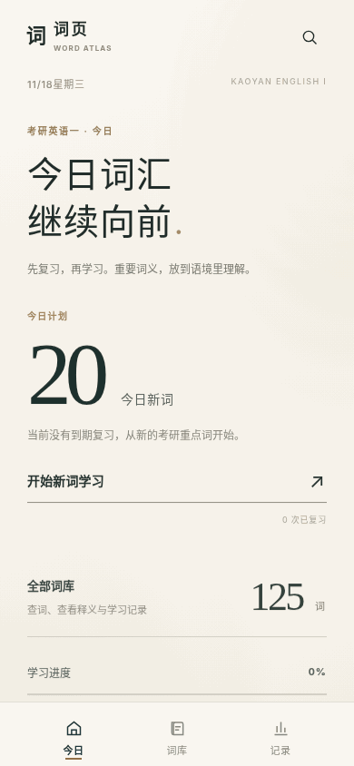
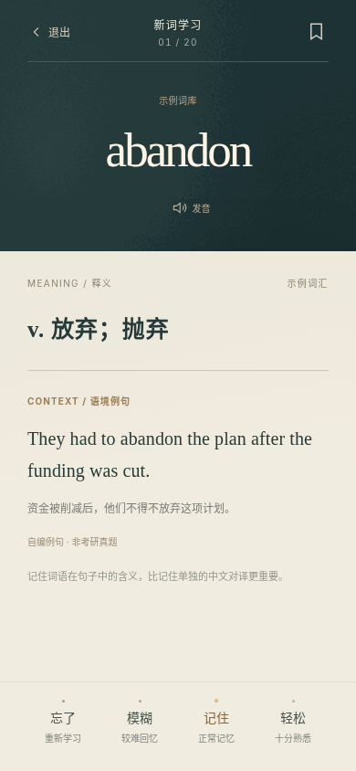
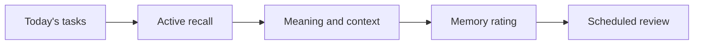

# Word World

**An offline, vocabulary-first app for China's postgraduate English I exam, with adaptive short lessons and an optional football league.**

Current version: `0.6.0-beta.1` (integration beta, not a stable release). [Changelog](CHANGELOG.md) · [Release policy](docs/RELEASES.md) · [Architecture](docs/ARCHITECTURE.md)

**Language / 语言: [简体中文](README.md) | English**

[](https://github.com/Alioth-31/Word-World/actions/workflows/test.yml)
[](LICENSE)
[](https://github.com/Alioth-31/Word-World/actions/workflows/build-apk.yml)

<p align="center">
  
  &nbsp;&nbsp;
  
</p>
<p align="center"><sub>Earlier interface screenshots; the generated app preview shows the current version</sub></p>

## Overview

Word World separates **dictionary lookup** from **memory practice**. A lookup shows definitions immediately; study sessions begin with active recall, followed by meaning and contextual examples, three-grade feedback, and spaced scheduling. Study progress remains on the device by default.



**Features**

- Short lessons: due reviews, new words and targeted usage practice within a personalized time budget.
- Focused practice: recall, reveal, contextual examples, and four-grade feedback.
- **Full vocabulary** — 5,530 authentic entries with pronunciations, meanings, source frequency counts, a 3,050-word core-list label and CET overlap information.
- **Exam-related ranking** — composite importance, independent 2010–2025 English I body-text estimates, mixed-source counts and personal knowledge gaps remain distinct.
- Structured usage: 36 focus entries and 41 independent pilot practice units with original teaching examples.
- Analytics: study activity, core-word coverage, delayed recall, weak items and scheduled workload.
- Optional Word FC: a virtual personal football league, with task-based scoring, season reports, vocabulary roster, scouting and due-item recovery practice.
- Dictionary — Chinese/English search, filters, bookmarks, and word details.
- Local records: on-device progress and JSON import/export.
- Spaced repetition: Android builds integrate `ts-fsrs`; standalone HTML previews use a simplified fallback scheduler.

## Browser preview

Requires **Node.js 22+**. From the repository root:

```bash
npm test
npm run preview
```

Open `output/preview.html`. No Android SDK is needed. The preview includes the **full 5,530-word dictionary**. Original demonstration sentences are supplementary; words, definitions, pronunciations and ranking data are primary.

## Android build

Open [GitHub Actions · Android APK](https://github.com/Alioth-31/Word-World/actions/workflows/build-apk.yml) and select **Run workflow**. Once the job succeeds, download the debug APK from that run's **Artifacts**.

On Windows, install Node.js 22+, JDK 21+, and the Android SDK, then run `build-android.cmd`. A successful build writes `output/word-world-debug.apk`.

> There is currently no production APK validated on a physical device. Android builds use the committed vocabulary without fetching updated rankings. Refreshing source data is an explicit operation (`npm run build:refresh-data`) and should be reviewed before committing regenerated assets. The Android workflow must run separately: a green Tests badge **does not** establish that the APK builds successfully.

## Repository layout

```text
app/                   Actual application, vocabulary and offline assets
  data/                Dictionary, exam frequency, senses and exercises
  js/                  Learning, analytics, league and composition
  styles/              Feature-specific styles
assets/                Android icon assets
scripts/               Vocabulary processing and build tools
tests/                 Automated tests
docs/                  Data notices and interface screenshots
.github/workflows/     Tests and Android build workflows
```

## Data, license and privacy

Original code is distributed under the [MIT License](LICENSE). The **bundled vocabulary is licensed under CC BY-NC-SA 4.0**, not this project's MIT license. Source frequency counts combine several English exams and are **not English I-only frequencies**. Composite importance rankings are an unvalidated learning heuristic.

- [Data sources and third-party licenses](docs/DATA.en.md)
- [Privacy notice](PRIVACY.en.md)
- [简体中文文档](README.md)
