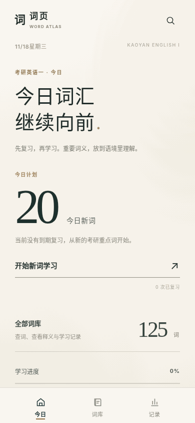
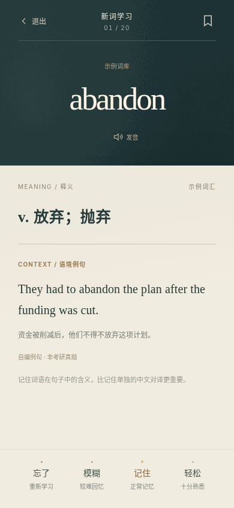
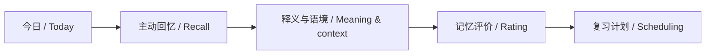

# Word World · 词页

**Offline vocabulary learning for China's postgraduate English I exam · 考研英语（一）离线词汇学习**

[简体中文](#简体中文) · [English](#english)

[](https://github.com/Alioth-31/Word-World/actions/workflows/test.yml)
[](LICENSE)
[](https://github.com/Alioth-31/Word-World/actions/workflows/build-apk.yml)

<p align="center">
  
  &nbsp;&nbsp;
  
</p>
<p align="center"><sub>实际界面截图，使用演示词汇 · Screenshots of the working interface with demo vocabulary</sub></p>



## 简体中文

Word World 是面向考研英语（一）的移动端词汇学习项目。界面以阅读为中心：学习时先回忆词义，再查看释义和语境，最后评价记忆情况；查词时则直接展示内容，不强制进入测试流程。

**主要功能**

- **今日学习**：区分到期复习与今日新词。
- **沉浸式学习**：回忆、揭示释义、语境阅读、四级记忆反馈。
- **词库检索**：支持中英文搜索、考研优先级筛选、收藏与词条详情。
- **本地记录**：学习进度保存在设备上，支持导入、导出 JSON 备份。
- **间隔复习**：Android 正式构建使用 `ts-fsrs`；单文件浏览器预览使用简化调度器。

**在浏览器体验**（需 Node.js 22+）：

```bash
npm test
npm run preview
```

用浏览器打开生成的 `output/preview.html`。无需 Android SDK；预览使用仓库内的 **125 条演示词汇**。

**构建 Android 调试 APK**：在 [Actions → Android APK](https://github.com/Alioth-31/Word-World/actions/workflows/build-apk.yml) 中选择 **Run workflow**。工作流成功后，在对应运行页面的 **Artifacts** 下载 APK。也可以在安装 Node.js 22+、JDK 21+、Android SDK 后，通过 Windows 的 `build-android.cmd` 构建。

正式构建会尝试获取完整考研词库及可用的英语（一）语料；当前仓库**没有已完成真机验收的正式发布 APK**。词汇优先级是根据来源数据计算的启发式评分，不是官方考试等级。数据来源、离线构建方式及许可边界参见 [数据与第三方许可](docs/DATA.md)。

## English

Word World is a mobile vocabulary-learning project for **China's postgraduate entrance examination, English I**. Its reading-first interface separates *active recall* from dictionary lookup: recall a word, reveal its meaning and context, then rate your memory. Looking up a word displays its definition immediately.

**Features**

- **Today** — due reviews and new words in separate learning paths.
- **Focused study** — recall, answer reveal, contextual examples, and four-grade feedback.
- **Vocabulary library** — Chinese/English search, priority filters, bookmarks, and word details.
- **Local progress** — learning records stored on device, with JSON import/export.
- **Spaced repetition** — Android builds bundle `ts-fsrs`; the standalone browser preview uses a simplified scheduler.

**Try the browser preview** (Node.js 22+):

```bash
npm test
npm run preview
```

Open `output/preview.html`. No Android SDK is required; the preview includes **125 demonstration entries**.

**Build a debug APK**: Open [Actions → Android APK](https://github.com/Alioth-31/Word-World/actions/workflows/build-apk.yml), select **Run workflow**, and download the APK from the successful run's **Artifacts**. For local Windows builds, install Node.js 22+, JDK 21+, and the Android SDK, then run `build-android.cmd`.

The full build attempts to retrieve postgraduate vocabulary data and available English I corpora. **No production APK has passed physical-device release validation yet.** Vocabulary priorities are heuristic scores, not official exam classifications. See [Data and third-party licenses](docs/DATA.md) for sources, offline preparation, and redistribution constraints.

## 项目结构 / Repository layout

```text
app/                 Application UI and study logic / 界面与学习逻辑
assets/              Android icon source / 安卓图标
data/                Demo vocabulary source / 演示词库源数据
scripts/             Data processing and preview build / 数据处理与构建
tests/               Automated tests / 自动测试
docs/                Data notices and screenshots / 数据说明与截图
.github/workflows/   Test and Android build automation / 自动化工作流
```

## 许可与隐私 / License & privacy

Original project code is licensed under **[MIT](LICENSE)**（原创代码采用 MIT 许可）. **Downloaded third-party vocabulary, exam texts and dependencies retain their own licenses**（第三方词库、真题与依赖遵循各自许可，不能视为 MIT 内容）。详见 / See [Data & licenses](docs/DATA.md).

学习记录默认保存在本机，不需要注册账号。/ Learning records are stored locally; no account is required. See [Privacy / 隐私说明](PRIVACY.md).
